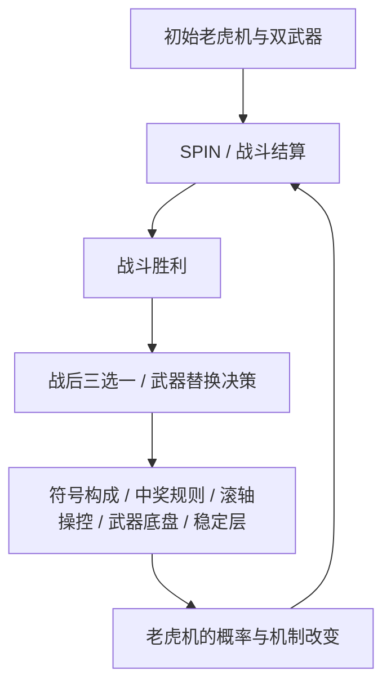

# Seek Dead · 局内成长与战后三选一重构策划案 V1.1

> 版本：V1.1（2026-11-19）
> 基于：V1.0 + 当日全部拍板 + 代码现状审查 + 行业最佳实践研究
> 核心定位不变（见 §0），但**结构、权重、牌谱定位、验收标准全面重写**。
> 相对 V1.0 的变更摘要见附录 A。

---

## 00. 一句话核心（不可动摇的设计北极星）

> **Seek Dead 的局内成长不是收集卡牌或升级角色，而是通过战后三选一与武器替换持续改造老虎机：
> 改变符号构成、中奖规则和滚轴操控能力，最终让玩家形成具有独特玩法的中奖引擎。**

这句话是全部设计决策的裁决标准。任何新机制若不能回答"它改造了老虎机的哪一部分、玩家能否在 SPIN 中看见它"，就不应进入成长系统。

### 0.1 V1.1 的核心裁决：把"中奖引擎"拆成一台可被看见的机器

借鉴 Balatro（把计分收敛为 `Chips × Mult` 一条公式）、Noita（魔杖 = 底座 × 符咒 × 修正器）、
Luck be a Landlord（符号层 vs 物品层），我们把 Seek Dead 的中奖引擎定义为一条玩家 5 秒能懂的公式：

```
单次 SPIN 收益 = Σ(符号基础赔付[武器底盘]) × 中奖规则倍率 × 滚轴增益
                  └──── symbol_mod 改造 ────┘  └─ 牌谱层 ─┘ └reel_control┘
                  武器 weapon 决定：底盘常数、符号槽位数、滚轴模式
```

四个改造方向因此各自有明确边界，不再互相重叠：

| 层 | 改造对象 | 对应公式段 | 经典参照 |
|---|---|---|---|
| **weapon 武器（底盘）** | 基础赔付常数、符号槽位数、滚轴模式（随机/顺序） | 整个引擎的底座 | Noita 魔杖属性 / Balatro 基础公式与 5 槽 |
| **symbol_mod 符号构成** | 哪些符号、各多少权重、符号间交互 | 符号基础赔付、符号生态 | Balatro 牌组 / LBL 符号 / Noita 投射物 |
| **pattern 牌谱（规则/放大器）** | 何时重触发、复制、条件改写、回绕 | 中奖规则倍率 | Balatro 放大器 Joker / Noita 修正器·触发器 / LBL 物品 |
| **reel_control 滚轴操控** | 权重倾斜、重转、锁定、吸附、顺序 | 滚轴增益 | Balatro reroll / LBL spinning / PRD·shuffled-bag |
| **survival 生存资源** | 治疗、护盾、金币、消耗品补给 | 风险对冲 | StS 精简/治疗 / Noita perks |

> 关于"技能"与"技艺"的术语澄清（见 §5E）：本项目有两套易混系统——
> **技能（selected_skills）**：整备期选入、成为转轮符号参与每次 SPIN 结算，属"符号构成"的一部分；
> **技艺（growth_system 8 项）**：被动增益（坚韧/守势/回春等），是独立的小型辅助系统。
> V1.1 全文用"技能"指前者、"技艺"指后者，不再混用。
> **消耗品（selected_consumables）**：不入轮，战斗中玩家主动点击使用（治疗/重转/攻击等），属主动干预层。

### 0.2 三条不可违背的设计铁律

1. **可见性**：每个奖励必须改变玩家下次 SPIN 中可观察的东西——符号分布、赔付数字、滚轴行为、触发反馈。纯后台数值累积不得作为奖励。
2. **底盘与放大器分离**：武器提供"发动机"，牌谱提供"放大器"。**放大器的价值来自放大谁（位置/组合），不是自身数值堆叠**——这是 V1.1 相对 V1.0 最关键的修正。
3. **没有废卡**（StS GDC 2019）：不存在"无论什么构筑都必拿"或"必跳过"的选项。必拿 = 过强（变反射），必跳 = 死奖励，二者都要重做。

---

## 01. 核心设计结论

### 1.1 四个改造方向（边界修订版）

V1.0 的四方向保留，但"中奖规则"的定义收窄——**不再是"既有牌谱的效果强化"**，而是"中奖结算的规则层改写"：

1. **符号构成**：符号池、符号权重、符号间的交互关系。
2. **中奖收益**：符号组合触发的伤害、状态、护盾、治疗及资源效果。
3. **中奖规则**：新组合规则、结算顺序/重触发/条件改写、签名机制。**不包含对牌谱数值的强化。**
4. **滚轴操控能力**：吸附、废铁转化、缓速启动等对结果/手感的有限干预。
   （当前：废铁改判每房1次 / 废铁转化+金 / 缓速启动；原"落点吸附""宽判窗口"已移除）

> 变更理由：V1.0 把"既有牌谱强化"列为规则改造的来源，与"牌谱只是放大器、不该强化"的拍板冲突；
> 同时 §B3 禁止倍率堆叠、§10.3 禁止牌谱成长层——三重约束下"强化牌谱"无合法空间。V1.1 直接移除。

### 1.2 新局内成长结构

- **战后三选一**：唯一主要成长分发器。
- **武器获取与替换**：改变底盘，是"变强"的主要来源；替换决策是核心玩法决策。
- **牌谱**：**全解锁的自动规则库**——由武器（key_paths）+ 符号牌型自动判定生效，无需习得、无需玩家管理。
- **技能（selected_skills，入轮）**：整备期选入，成为转轮符号参与每次 SPIN 结算，是"符号构成"的组成部分；不入三选一池。
- **消耗品（selected_consumables，不入轮）**：战斗中玩家主动点击使用的即时手段（治疗/重转/攻击/净化等）；不入三选一池，通过商店/战利品补给。
- **技艺（growth_system 8 项，被动）**：少量被动增益，不形成独立成长树；**与 reel_control 去除能力重叠**（见 §5E）。
- **护符**：开局策略选择，不形成局内升级树。
- **生存与资源**：支撑激进构筑的风险对冲，不是主成长方向。

### 1.3 目标循环



---

## 02. 成长体验目标

每次获得奖励后，玩家应能回答至少一个问题：

- 哪种符号更容易出现，或符号池发生了什么变化？
- 哪个组合的收益更高，或中奖后产生了什么新效果？
- 我的武器是否改变了符号槽位数、滚轴模式或赔付常数？
- 我现在可以怎样更有效地干预滚轴？
- 我是继续强化现有中奖引擎，还是用新选择改变方向？

**奖励不能只是玩家看不见的数值累积。** 若一个效果无法在 SPIN、赔付数字、滚轴行为或战斗反馈中观察到，它就不是合格的成长奖励。

---

## 03. 战后三选一的职责

统一发放六类内容：符号改造、中奖规则改造、滚轴操控、武器、技艺、生存与资源。

### 3.1 统一生成器，类别与具体奖励两级权重

所有候选由统一三选一生成器（Draft Composer）产出：先选类别，再从类别内按具体权重选奖励。
类别权重与具体奖励权重**分开管理**，且类别权重只在"当前有合法候选"的类别间归一化。

### 3.2 三选一的组成规则

- 三个选项尽量跨类别（同类别最多 2 张，软限制非硬禁）。
- 至少一张是"立即可见变化"类（符号权重、武器替换、滚轴操控）。
- 品质梯度：common 70% / uncommon 25% / rare 5%（Balatro/StS 经典梯度），随房间进度微调。
- 每个效果描述 ≤ 4 行 / 20 词（Balatro 可读性纪律），说不清就不要上线。

---

## 04. 一级奖励池结构（V1.1 新权重）

### 4.1 类别与权重

| 类别 | V1.0 权重 | **V1.1 权重** | 变更理由 |
|---|---:|---:|---|
| symbol_mod 符号改造 | 25% | **28%** | 符号是"组成"，维持核心地位；承接 rule_mod 部分预算 |
| rule_mod 中奖规则改造 | 25% | **12%** | 收窄为"新组合/规则改写"，不再是牌谱强化，大幅下调 |
| reel_control 滚轴操控 | 15% | **16%** | 略升，承接操控能力从技艺迁入 |
| weapon 武器替换 | 12% | **20%** | 武器是"底盘/主要变强来源"，上调至第二高 |
| skill 技艺 | 8% | **6%** | 与操控去重后收缩，只留生存/运筹/事件型 |
| survival_resource 生存资源 | 10% | **12%** | 作为激进构筑的风险对冲，略升 |
| signature 签名习得 | 5% | **0%（删除）** | 签名全解锁，无习得环节，类别撤销 |
| **合计** | 100% | **100%** | |

> 权重即"出现率"，不是"价值等级"；稀有度单独用 70/25/5 梯度控制，不得让隐藏权重与卡面品质冲突。

### 4.2 槽位倾向（软偏置，非硬编码）

借鉴 Balatro "5 槽黄金比例"与 StS "情境化选择"：三选一不硬编码"第几槽放什么"，
而是给偏好类别一个 1.5× 软偏置，最终仍按归一化权重抽，并强制组内跨类别覆盖。
当前实现（SLOT_BIAS=1.6、DIVERSITY_BONUS=1.5、同类≤2）符合此原则，保留。

### 4.3 生成流程（V1.1 定稿）

1. 读取本局快照（构筑、血量、房间、资源）。
2. 计算当前可用类别（有合法候选的类别）权重，按 §4.1 动态重分配。
3. 三槽抽取：权重 × 槽位软偏置 × 组内多样性因子（未出现类别放大）。
4. 合法性过滤：满血滤治疗、符号不存在、武器槽满、重复、超限、池耗尽。
5. 稀有度分层：70/25/5 梯度，精英/Boss 房提高 rare 比例。
6. 同质化检查：同类≤2、跨类别覆盖。
7. 替补与兜底：池不足时按权重补，绝不空屏、绝不假卡。
8. 展示并写入遥测（见 §9）。

**动态权重必须加滞回与限幅**：类别权重随局内状态变化时使用有界增量 + 冷却，
避免"一旦走了 symbol 流就再也抽不到 reel_control"的自锁（加权选择最佳实践）。

### 4.4 保底原则（修订）

- 取消 V1.0 §6.3 "不要形成类别保底承诺"的绝对表述，也不保留 V1.0 之外的隐式 15% 注入。
- **认可技艺的"前 3 个有效普通奖励房一次性保底"**（当前实现），因为它保护"决策质量"——
  让玩家在早期至少见到一次技艺，理解系统存在；但它**不保证胜利、不保证拿到强力选项**。
- 保底必须静默生效并写日志，供平衡调参；UI 不解释概率（LBL "感觉公平"原则）。
- 多层保底：短期（连续 N 次未出目标牌型则提升符号权重）、中期（shuffled-bag 保证牌型铺开）、
  救济（资源见底时补一次 spin）。目标始终是"每次三选一都有意义"，不是"保证通关"。

---

## 05. 各类奖励内容设计

### A. 符号改造 symbol_mod（28%）

符号是"可组合的内容单元"，设计重心是**符号之间的关系**而非单个数值（LBL 核心做法）。

- **A1 符号权重强化（已实现）**：对当前武器符号池里的符号 +3 权重，必跨一个格数阈值、当场可见；
  单符号上限 6（最多 2 次），满格（4 格）符号跳过。MVP 足够，后续扩"符号特性改造"。
- **A2 符号效果强化（待补，V1.1 新增接口方向）**：为符号本身增加结算特性——燃烧增强、
  霜冻增强、毒持续伤害、暴击/穿透强化。**这是 V1.0 A2 的遗留缺口**，需新增对应 effect_id，
  直接改符号结算参数（不是改牌谱）。
- **A3 符号生态交互（中期）**：定义"符号交互表"（A+B 触发额外赔付、C 可移除 D），
  让 symbol_mod 选择变成"搭建符号生态"。复杂度分层呈现：前期只出简单符号，复杂交互随进程放出
  （MTG "新世界秩序"，LBL 做法）。
- **角色生态位标签**：每个符号改造打上"垫地基 / 补稳定 / 做乘算 / 做放大器 / 清负资产"标签，
  三选一界面提示"你当前缺哪一类"（Balatro 四角色 + 黄金比例做法）。

### B. 中奖规则改造 rule_mod（12%，V1.1 收窄）

**明令禁止**：对牌谱做数值/倍率强化（用户拍板 + §B3 + §10.3 三重约束）。
合法内容只有三类：

- **B1 新组合规则**：引入新的符号组合玩法，仍以滚轴符号组合触发、自动判定结算，
  有可识别视听反馈、有明确触发频率/上限（防过载）。例如"三种不同元素同时出现 → 额外一次结算"。
- **B2 结算顺序 / 重触发改写**：改变中奖的**执行顺序**而非数值——如"末位结算后回到首位再触发一次"
  （Noita wrap / Balatro Blueprint 位置依赖）。这是"牌谱=放大器"的正确用法。
- **B3 状态联动**：把某个中奖结果改写为另一种战斗收益，或让特定状态与某组合联动。
  例如"燃烧层数≥3 时，火系中奖转为穿透"。
- **稀有度与代价**：强力改写（B1/B2）用自毁 / 占槽 / 副作用平衡，而非削数值（Balatro Mr. Bones/Cavendish 语法）。

> V1.0 的 B1"既有牌谱强化"整段删除；3 张 SIG02 参数卡已随签名全解锁移除。

### C. 滚轴操控 reel_control（16%）

- **能力唯一归属（已实施）**：操控能力统一归 reel_control 类别池；技艺侧同名能力已迁出（P1.1③）。
- **当前三张操控卡（B方案 + 二轮 F6 调整，2026-11-19）**：
  - `control_trash_reroll` 废铁改判：**每房 1 次**，废铁落点改判为相邻有效符号（补救型、
    有明确正面收益；替换原"落点吸附 ±2"——用户否决其为"盲目干扰、无正面收益"）
  - `control_mercy` 废铁转化：废铁落点 +2 金币，每回合 1 次（不抵消空转）
  - `control_slow_ramp` 缓速启动：每拍加速度 ×0.75（0.0051→0.0038），约 2 秒到顶速
    （替换原"宽判窗口"这个隐形能力；用户拍板"减小每拍加速度"）
  - 两张废铁卡并存：改判把坏格变好，转化把坏格变资源，频率与用途不同。
- **重做理由**（见 `docs/方案_操控卡重做_2026-11-19.md`）：原三张卡强度/感知错位——
  废铁豁免是"每回合免死金牌"过强，宽判是"纯容差放宽"几乎无感。B方案让三张都改"结果"、
  有明确收益提示，感知一致。
- **触发次数与范围有限**：吸附有每回合次数与 ±2 格上限，废铁转化每回合 1 次，
  缓速是常驻小幅减速——符合"有限干预、保留随机"原则。
- **动态权重滞回**：当某类符号/机制过度 dominant 时，用软限幅而非硬禁降低其出现率，
  迫使玩家在多个方向间轮换（LBL 反强制策略）。

### D. 武器替换 weapon（20%，V1.1 从 12% 上调，核心入口）

**这是 V1.1 相对 V1.0 最大的结构性补强**——V1.0 口头上"武器是底盘"却只给 12% 权重，
且当前代码 draft 路径 `settle_loot_replace` 直接返回 `replace_not_supported_in_draft`，核心入口缺失。

- **武器定义底盘三参数**（Noita 魔杖直接参照）：
  ① 符号/牌谱槽位数；② 滚轴模式（完全随机 / 顺序可控）；③ 基础赔付常数。
- **换武器 = 换一整套解释规则**，不是只换数值。不同武器应显著改变中奖引擎的玩法倾向。
- **替换界面信息完整**：显示新旧武器属性、符号权重、机制差异、牌谱兼容（key_paths）、失去内容。
- **决策呈现**：替换是核心玩法决策，不是自动替换；玩家需主动选择换不换。
- **品质语法**：高阶武器替换可带真实负面（更高赔付但滚轴更不稳定），对应 StS Boss 遗物语法。

### E. 技艺 perk（6%，与操控去重后收缩）

> 术语：此处"技艺"指 `growth_system` 的 8 项被动增益，为与"技能"区分，文档中改称"技艺 perk"。

- 保留 8 项中的**生存/运筹型**：坚韧、守势、回春、备用药剂、积蓄。
- **迁出 3 项目押型**（snap/wide/mercy）到 reel_control，消除与操控类别的重复。
- 技艺是"少量被动辅助"，不形成独立成长树；前 3 房一次性保底，仅此一个保底。

#### E.1 技艺池优化方案（2026-11-19 拍板：删 3 补 3，保池深 8 项）

**问题**：直接删除 3 项目押技艺后只剩 5 项，会引发三处退化——
① `roll_choices()` 目标返回 3 个未拥有候选，剩 5 项时拿到 3 个后只能返回 2 个；
② 一局约拿 3-5 个技艺，5 项池后期会抽干；
③ `FAMILIES` 三家族轮转（survive/plan/aim）删空 aim 后第 3 槽永远走"剩余补齐"。

**方案**：删 aim 系 3 项，**补 3 项新的生存/运筹型技艺**，池深维持 8 项，操控能力唯一归 reel_control。

| 删除 | 补位（建议，待确认具体效果） | 效果落点（走现成接口，不新增系统） |
|---|---|---|
| `snap` 落点吸附 | **蓄能** | 每房开局 +护盾，复用 `room_shield()`（与守势同类，数值待定） |
| `wide` 宽判窗口 | **回收** | 每房胜利 +金币，复用 `apply_victory_perks()`（与积蓄同类，数值待定） |
| `mercy` 废铁豁免 | **余裕** | 每房胜利若满血则 +金币/护盾，同样走 `apply_victory_perks()` |

> 补位三项均为**被动、生存/运筹向**，与操控卡零重叠；复用现有 `pick()`/`apply_victory_perks()`/
> `room_shield()` 三个落点，不新增机制。具体数值与"余裕"是否值得单列，待真人 F6 后定。
> 同步清理：`FAMILIES` 常量去掉 `aim` 键、`_has_control()` 去掉 `has_perk()` 分支（技艺不再授予操控）。

### E2. 技能 skill（入轮，非三选一类别）

**技能不属于战后三选一池**——它在整备期选入，成为转轮符号参与每次 SPIN 结算（代码：`SkillData.symbol` 注入转轮池，`base_power`/`crit` 写入符号映射）。

- 技能是"玩家主动采用的符号构成"，但**结算是被动的**（加入转轮后自动生效，无需每回合操作）。
- 42 个技能资源按元素/效果（护盾/治疗/中毒/霜冻/增伤等）分类，是 symbol_mod"符号生态"的重要组成。
- 设计含义：技能扩大了玩家可构筑的符号空间，与 symbol_mod 的"符号权重/符号交互"形成完整的符号改造闭环。
- V1.1 不把技能塞进三选一——它是构筑前的"底盘选择"之一（与武器、护符同级）。

### E3. 消耗品 consumable（主动，不入轮）

**消耗品也不属于战后三选一池**——它不入转轮，是战斗中玩家主动点击使用的即时手段（代码：`consumable_system.use()`，含治疗/重转/攻击/净化/破甲等）。

- 消耗品是**主动干预层**：与 reel_control（被动/自动的滚轴能力）互为补充——
  reel_control 是"常驻的小幅可控"，消耗品是"关键时刻的一次性大动作"。
- 腰带槽位有限（当前 4 格 2×2），通过商店/战利品补给，形成资源决策。
- 与 survival 类别的关系：survival 卡可补金币/消耗品，但"具体消耗品"本身不入三选一。

### F. 生存与资源 survival_resource（12%）

- 定位：**激进中奖引擎的风险对冲**，不是主成长方向（Noita perks 免疫 / StS 精简治疗的参照）。
- 现有 3 项（治疗/护盾/金币）保留，MVP 补到 4-6 项（如**消耗品补给**、复活/保命一次）。
- 满血滤治疗、无目标滤护盾，避免死奖励。

### G. 签名 signature（删除习得类别，改为全解锁规则层）

**V1.1 重大变更**：取消"三选一习得签名"，11 张图纸卡全部删除，signature 类别撤销，5% 权重并入 weapon/symbol。

- 签名 = **那把专属武器的内置能力**（key_paths 绑定），玩家携带该武器 + 凑齐牌型 → 自动生效。
- 与基础牌谱统一为"全解锁自动规则库"，玩家通过武器与构筑自行触发，无需管理、无需习得。
- 保留条件：① 携带专属武器；② 签名自身 match_rule 牌型满足。三条件变两条件。
- 签名价值在**玩法辨识度与构筑组合空间**，不是数值增幅（重写 V1.0 §10.4）。

---

## 06. 牌谱系统定位（V1.1 重写）

### 6.1 定义

牌谱是**全解锁的自动规则库**：基础牌谱按武器条件 + 符号组合自动判定生效；
签名牌谱按专属武器 + 特定牌型自动判定生效。玩家在战斗外不管理牌谱。

### 6.2 牌谱基线（更新 V1.0 的"21 张"过时数字）

- 基础牌谱 9 张（w01-w06、t01-t03）+ 签名牌谱 11 张 = **20 张规则资源**。
- V1.0 的"21 张"含已删除的 s02 独立资源，V1.1 更正为 20 张。
- 删除的 11 张签名图纸卡 + 3 张规则参数卡**不是牌谱资源**，是三选一奖励卡，不计入此数。

### 6.3 牌谱与奖励的关系（铁律）

- 牌谱**只做放大器/规则层**，不做数值强化（§0.2 铁律 2）。
- 奖励可以"授予新组合规则"或"改写结算顺序"，但**不得对既有牌谱做参数强化**。
- 签名全解锁后，不再有"习得率"指标，改为"触发率 / 触发收益 / 构筑搭配率"。

---

## 07. 稀有度与房间进度

### 7.1 稀有度梯度

- 三选一品质：common 70% / uncommon 25% / rare 5%（Balatro/StS 经典梯度）。
- 精英房：提高 rare 比例（类比 StS 精英必掉 uncommon+）。
- Boss 房：走专属奖励流程，高级武器替换/规则改写可带负面（Boss 遗物语法）。

### 7.2 房间进度

- 普通战斗：基础权重，侧重 symbol_mod / reel_control 铺开。
- 精英战斗：提高 weapon / rule_mod / rare 品质。
- Boss：专属奖励 + 幕间节点。
- **待定项（需拍板）**：ACT 幕间锻魂是否仍发 +8 攻击/+20 HP 双属性套餐——
  V1.0 §7.1 建议"不再提供、单独定稿"，V1.1 建议**改为一次三选一**（与核心定位一致），待拍板。

---

## 08. 重抽机制（沿用 V1.0，已实现）

整组三张替换、价格首 5 金递增 +5、价格可见、无法支付不允许、重抽后仍过滤去重、
不重置类别偏置/房间权重、不新增免费货币。静默记录重抽触发日志用于平衡。

---

## 09. 遥测与数据驱动平衡

### 9.1 埋点

每个三选一选项记录：draft_id、展示/选择/跳过、稀有度、类别、选中时构筑快照、
选中后 N 场内的收益变化、重抽次数、武器替换率、签名触发率/触发收益。

### 9.2 平衡方法（StS "数据是证据不是结论"）

- 用 pick-rate / win-rate 自动标记"过强（总拿）"与"死奖励（从不拿）"候选。
- **必须分桶分析**（构筑方向 × 阶段 × 血量），避免像 StS "疯狂"卡那样误杀情境型强选项。
- 数据驱动剪枝：长时间无人选或过强的效果，优先重做机制而非单纯改数值。
- 可复现 seed 跑数千次模拟，检查"某类别消失 / 某稀有度断档 / 死奖励池"。

---

## 10. 旧系统迁移与去留（V1.1 明确化，消除 V1.0 口径矛盾）

V1.0 对旧系统的删除口径混乱（"删除" vs "不作为主成长轴" vs "不再依赖"三种说法并存），
且铁砧删除挂在"若此前已决定"的条件句上，导致 P3 无法排期。V1.1 统一为：

| 旧系统 | V1.1 结论 | 执行阶段 |
|---|---|---|
| 武器熟练 R1-R4 / 铭印 / 槽位铭印 | **彻底删除**（统一口径，不再"保留为次要"） | P3 |
| 攻击研磨（run_power_bonus） | 并入 symbol_mod（作为符号伤害成长），不保留独立轴 | P3 |
| 铁砧点数 / gacha 抽取 / 保底 | **删除**（确定语气，不再"若已定方向"），局外改成就解锁 | P4 |
| 幕间锻魂 +8/+20 双属性 | 改为一次三选一（待拍板） | P3/P4 |
| 旧三选一 LootOffer 路径 | 保留用于 Boss/探索/商店，普通战斗已迁 Draft | 已完成 |

> **P3 安全门**：删除旧数值成长的前提是"新成长输出曲线验证通过"——需真人 F6 二次验收 + 遥测数据证明
> 新引擎能顶住伤害曲线。安全门未过前，旧系统不得删除（这是为了防止成长断层，不是推迟决策）。

---

## 11. 实施优先级（更新状态）

| 阶段 | 状态 | 内容 |
|---|---|---|
| P0 统一生成器 | ✅ 已完成 | 类别权重/槽位/同质化/兜底、字段兼容、可解释日志 |
| P0 最小内容 | ✅ 已完成 | 符号权重强化、生存资源、技艺保底迁移 |
| P1 结构修复 | ✅ 已完成 | 多样性修复、reel_control 补齐、pattern 覆盖（已废弃） |
| P1 签名全解锁 | ✅ 已完成 | 删 11 图纸+3 规则卡，签名改武器内置自动生效 |
| **P1.1 补核心缺口** | ✅ 已完成（2026-11-19） | ① 武器替换接入 draft（settle_loot_replace）② 符号效果强化 A2 接口（symbol_effect_bonus）③ 技艺优化：删 aim3 补生存/运筹3、操控唯一归 reel_control（见 §5E.1） |
| 技能/消耗品不入三选一 | ✅ 已拍板 | 维持跨局解锁 + 整备期/主动使用定位，不进池（见 §5E2/§5E3 与专门决策文档） |
| P2 内容扩充 | 待定 | 符号生态交互、规则改写卡、武器池扩充 |
| P3 旧系统删除 | 受安全门约束 | 熟练/铭印/铁砧删除，需 F6 + 数据验证 |
| P4 局外与平衡 | 待定 | 成就解锁、平衡迭代 |

---

## 12. 验收标准（V1.1 可执行化，取代 V1.0 定性描述）

### 12.1 生成系统（可自动化测试）
- 每次三选一返回 3 张合法候选，无重复 ID，同类≤2。
- 连续 1000 组生成：每个启用类别出现率与 §4.1 权重偏差 < 10%（相对值）。
- 满血滤治疗、无目标滤护盾、池耗尽有替补、绝不空屏。
- 重抽递增价格正确、资金不足拒绝、不刷取漏洞。
- 动态权重有滞回/限幅，无"类别自锁"。

### 12.2 玩家体验（需真人 F6 + 遥测）
- "没有废卡"检查：不存在必拿/必跳选项（pick-rate 长期 >80% 或 <5% 需复查）。
- 可见性检查：每个奖励能在下次 SPIN 中观察到变化。
- 情境化检查：同一选项在不同构筑下价值有明显差异。
- 输出曲线：新成长能顶住当前敌人伤害曲线（P3 安全门）。

### 12.3 定性约束的数值化（V1.0 遗留问题修复）
| V1.0 定性说法 | V1.1 数值口径 |
|---|---|
| "触发次数有限" | 吸附每回合 ≤2 次、宽判范围 ≤±2 格、豁免每回合 ≤1 次 |
| "明确触发频率" | 新组合规则每场战斗 ≤N 次（N 由内容卡声明） |
| "可识别视觉反馈" | 每次中奖规则触发有独立飘字 + 音效，测试可断言反馈事件 |
| "不要过载" | 单次 SPIN 的规则改写触发 ≤3 条，超出部分截断并日志 |

---

## 13. 一句话总结（更新）

> Seek Dead 的局内成长不是收集卡牌或升级角色，而是以**武器为底盘、符号为组成、牌谱为全解锁规则层**，
> 通过战后三选一与武器替换持续改造老虎机：改变符号构成、中奖规则与滚轴操控，
> 让玩家形成具有独特玩法的中奖引擎。**变强的是底盘与组合，不是升高的数字。**
>
> 其中：**技能**入轮、成为符号构成的一部分（主动采用、被动结算）；
> **消耗品**不入轮、是战斗中主动点击使用的一次性干预；两者都不进战后三选一池。

---

## 附录 A：V1.0 → V1.1 变更摘要

| # | 变更 | 理由 |
|---:|---|---|
| 1 | 四方向边界收窄："中奖规则"不再含牌谱强化 | 用户拍板"牌谱只是放大器" + §B3 + §10.3 |
| 2 | 签名改全解锁，删 signature 类别与 11 图纸卡 | 用户拍板"牌谱全解锁自己构筑" |
| 3 | 武器权重 12%→20%，明确为"变强主要来源" | 用户"实际变强的是武器" + 代码审查核心入口缺失 |
| 4 | rule_mod 25%→12%，收窄为新组合/规则改写 | 消除"25% 却无合法内容"的核心矛盾 |
| 5 | 技艺 8%→6%，3 项目押能力迁出 reel_control | 消除 V1.0 遗留的技艺/操控重叠 |
| 6 | 四类分层映射经典游戏（底盘/组成/规则/放大器） | 提升可执行性与行业对齐 |
| 7 | 稀有度 70/25/5 梯度明确化 | Balatro/StS 经典实践 |
| 8 | 动态权重加滞回/限幅、保底护决策质量 | 加权选择最佳实践 |
| 9 | 旧系统删除口径统一为"彻底删除"+ P3 安全门 | 消除 V1.0 三种口径矛盾与条件句卡点 |
| 10 | 验收标准数值化 | V1.0 定性描述无法验收 |
| 11 | "21 张牌谱"更正为 20 张 | 删卡后基线数字过时 |
| 12 | P0/P1 标"已完成"，语气从"建议/将"改"现状" | 文档与实现状态对齐 |
| 13 | 澄清三套易混系统：技能（入轮/主动采用）/ 消耗品（不入轮/主动使用）/ 技艺（被动增益 perk）；前两者不入三选一池 | 用户指正，V1.0 曾混用术语 |
| 14 | **拍板：技能/消耗品不进三选一**（维持跨局解锁定位），依据行业"解锁进池而非直发"实践 | 用户决策 + 设计决策文档 |
| 15 | 技艺池优化：删 aim3（snap/wide/mercy）+ 补生存/运筹3，池深保持 8；操控唯一归 reel_control | 消除重复 + 防池抽干（§5E.1） |

## 附录 B：行业实践来源

- Balatro：LocalThunk 访谈（Game Informer）、Joker 四角色与 5 槽黄金比例、70/25/5 稀有度、可读性纪律
- Slay the Spire：GDC 2019 Anthony Giovannetti（"没有一张废卡""情境化选择""数据是证据不是结论"）
- Noita：魔杖 = 底座 × 符咒 × 修正器/触发器、wrap/trigger/conditional 状态机、涌现式构筑
- Luck be a Landlord：Dan DiIorio 访谈（符号层 vs 物品层、复杂度分层、隐性偏袒、反强制策略）
- 通用：PRD / shuffled-bag / pity（体感公平）、加权选择滞回限幅、分层抽样与软保底

> 本附录为设计依据索引，详细出处见 `docs/` 下当日研究记录与审查报告。
