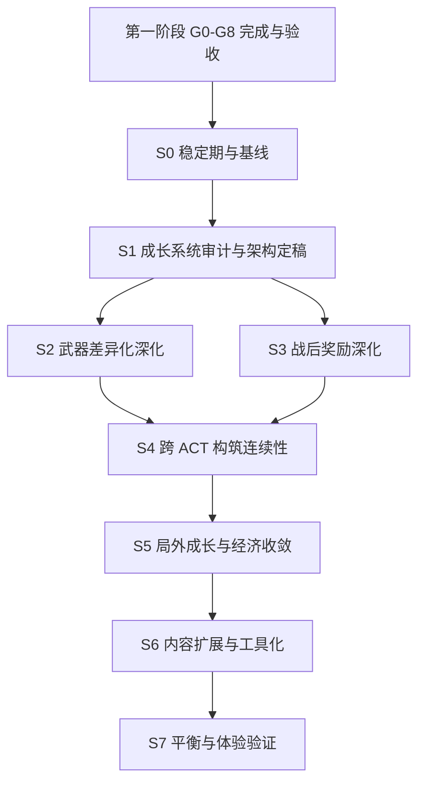

# Seek Dead · 核心玩法全局优化与重构完成后的后续优化方案

> 文档定位：第一阶段《核心玩法全局优化与重构执行方案》完成、验收并稳定后，作为第二阶段优化的规划与决策基线。  
> 本文不替代第一阶段执行方案，不允许提前打断 G0–G8 的既定顺序。  
> 状态：**已批准的方向基线（2026-11-20）**；铁砧删除与 G8 结案口径已按用户决策更新，S0 为当前启动阶段。  
> 日期：2026-11-20  
> 2026-11-20 决策更新：① 铁砧**明确删除**，按 S5 顺序执行，不回退 G7-3 定向解锁成果；② G8 **工程结案**，真人与试玩环节**全部延后**（用户不填清单/表格，改为随时提问题，收到即处理）；③ S0 先建立**跨局 JSON 数据汇总**，再做依赖行为数据的平衡决策。详见 §1.3 与 §6。

---

## 1. 文档目标与启动条件

本方案用于定义 Seek Dead 在核心玩法全局优化与重构完成后，下一轮系统性优化的目标、优先级、拆分方式、验证标准与风险控制。

### 1.1 启动条件（全部满足）

- [x] 第一阶段 G0–G8 按既定依赖完成，或所有未完成项有明确批准的延期记录。
  - G8 **工程结案**（2026-11-20 用户决策）：自动化验收全过（资源扫描 346 全 OK、6 种子多路线中位全过基线、全量测试绿）。真人与试玩环节全部延后：用户不填清单/表格，改为随时提出问题，收到即处理；不阻塞阶段线。
  - G6/G7 遗留项（旧 gacha 兼容、G7-2 换装曲线前置、G6-1 回退、G7-4 独立面板）登记为**批准延期**，纳入 S5 / S7 处理，不阻塞 S0–S4。
- [x] 核心战斗循环、战后结算、武器仓库/切换、符号带编辑及关键交互通过验收（G1–G5 自动化验收通过）。
- [x] 关键数据、奖励生成、结算和存档交易安全性达到阶段验收标准（G1 事务、G2 统一仓库与图鉴分离已完成）。
- [ ] 旧系统迁移和删除已完成必要的兼容、数据迁移及回归验证。
  - **例外批准**：铁砧 gacha/货币/保底/入口的删除按 S5 顺序执行，属于**已批准的延期迁移**，不阻塞 S0–S4 启动。G7-3 定向解锁成果（`directed_unlocks`、点数折算、`earn`/`claim`）在 S5 中保留并迁移，不回退。
- [ ] 有可用于对比的基线：局内表现、玩家行为、失败/通关分布、奖励选择与武器使用数据。
  - 局内表现基线已有（G5/G8 输出曲线）；**行为数据基线缺口由 S0 建立跨局 JSON 汇总补齐**，在此之前不做依赖行为数据的平衡决策。

若启动条件未满足，继续修复第一阶段问题，不以本方案中的新系统设计作为理由插入新的架构工作。

### 1.2 第二阶段总体目标

第二阶段的目标不是继续堆叠系统，而是让现有核心玩法形成清晰、互相支撑、可持续扩展的结构：

1. **成长的可理解性**：玩家能理解武器、符号带、奖励和资源各自承担什么作用。
2. **构筑的连贯性**：一次战斗获得的奖励能强化、改变或延伸已有构筑，而非不断重开。
3. **武器的差异性**：武器之间的差异来自机制、符号结构、规则与构筑适配，而不仅是数值。
4. **ACT 之间的连续性**：后续 ACT 延续玩家已有构筑，给予升级、扩展、修正或有意义的转型机会。
5. **局外成长的克制性**：局外系统主要提供内容解锁、认知与选择空间，不形成大量随机数值抽取和重复养成负担。
6. **可扩展性**：新武器、新符号、新奖励和新敌人能通过数据与规则扩展，而不是频繁改动核心架构。
7. **可验证性**：优化能通过行为数据、测试和明确验收标准判断效果，不以主观感受作为唯一依据。

### 1.3 2026-11-20 用户决策更新（优先级高于下文方向性表述）

| ID | 议题 | 已批准决策 | 影响阶段 |
|---|---|---|---|
| U-01 | 铁砧去留 | **明确删除**。按 S5 顺序执行，不回退 G7-3；**保留并迁移** `directed_unlocks`、点数折算、`earn`/`claim` API；删除 gacha 摇奖、货币、保底、重复返还与铁砧入口；过渡期旧系统仅兼容维护、**不再新增依赖** | S1 记录 / S5 迁移 |
| U-02 | 局外收藏来源 | 武器、护符、技能统一支持"局内实际获得后写入局外收藏"；保留商店、事件、宝箱、精英/Boss 等主题来源；由**生涯**提供定向解锁；审计并迁移全部铁砧独占内容 | S1 审计 / S5 迁移 |
| U-03 | G8 验收 | **工程结案**；真人与试玩环节全部延后（20:0x 更新），用户不填清单/表格，改为随时提问题、收到即处理，不阻塞阶段线 | —（延后） |
| U-04 | 行为数据 | S0 先建立**跨局 JSON 数据汇总**，再开展依赖行为数据的平衡决策；在此之前不以主观感受驱动平衡 | S0 / S7 |

> 下文中凡出现"铁砧倾向收敛或移除""铁砧是否整体移除仍须决策"等表述，均以本表 U-01/U-02 为准：方向已确定为删除，仅执行时机（S5）与迁移范围待规格。

---

## 2. 现状问题与优化方向

以下是此前设计讨论中提出的方向性问题，需在第一阶段结束后结合代码、数据和实际游戏表现重新审查；并非对当前实现的最终审计结论。

### 2.1 成长系统职责重叠

曾讨论的系统包括武器熟练度/等级、铭文、符号槽位成长、技能成长、锻造/精炼、ACT 临时奖励、护符、符号与牌谱相关机制、铁砧及局外成长等。

风险：多个系统同时服务于“让武器变强”，玩家难以理解成长来源，开发也难以平衡、维护与扩展。

**方向：重新划分职责，避免多个系统重复提供相同成长价值。**

### 2.2 武器更换成本过高或存在重启感

如果成长强绑定具体武器，玩家更换武器时可能损失投入；如果武器主要由数值区分，选择又容易退化为比较面板。

**方向：武器作为构筑引擎和组件，玩家的核心构筑投入尽可能跟随玩家或构筑结构，而非被单一武器绑定。** 具体保留、移除或迁移熟练度等系统，须在后续系统审查中决策。

### 2.3 构筑缺少跨 ACT 连续性

ACT 之间如果频繁清空、重置或迫使玩家重新寻找核心构筑，会削弱长局中的成长叙事。

**方向：后续 ACT 优先强化、扩展、精炼玩家已建立的构筑核心；必要时提供有成本且有吸引力的转型机会。**

### 2.4 局外随机成长可能掩盖局内构筑

局外随机抽取、重复补偿、数值积累和资源消耗若过多，可能使局内决策价值降低，并增加维护成本。

**方向：审查局外系统的必要性，优先保留内容解锁、收集、图鉴、记录和新的玩法选项；减少重复的随机数值经济。**

**已决策（U-01/U-02）：铁砧明确删除，按 S5 顺序执行。** 删除 gacha 摇奖、货币、保底、重复返还与铁砧入口；保留并迁移 G7-3 定向解锁（`directed_unlocks`、点数折算、`earn`/`claim`），由生涯提供定向解锁。武器、护符、技能统一由局内实际获得写入局外收藏，保留商店/事件/宝箱/精英 Boss 等主题来源。过渡期旧系统仅兼容维护、不再新增依赖。

### 2.5 内容数量与机制深度之间的平衡

武器数量本身不是差异化的保证。大量武器若只是数值变化，会增加制作与平衡成本。

**方向：保留既有内容资产和目标数量的前提下，逐步提高机制、符号结构、规则互动及构筑定位的差异性，不以大规模删内容作为默认手段。**

### 2.6 武器获取与战后三选一的整合原则

> **第一阶段已完成情况（2026-11-20 核对）**：以下整合框架的主体已在 G2 落地，不是本阶段新建工作——
> `weapon_acquire`（新武器获取）/`weapon_swap`（本局仓库换装）已拆分并统一进 `_draft_extra` 三选一池；
> `remember_weapon()` 统一把局内实际获得的武器写入局外收藏与本局仓库，图鉴首次发现独立记录；
> 武器专属结算分支、needs_replace 替换弹层、只结算一次守卫、完整换装比较均已实现。
> 因此本节剩余工作仅为**频率调优与节点价值分层**（S3），不重复建设框架；下表"节点奖励方向"中普通/精英/Boss 的武器出现频率需按已实现的 composer 权重实测后再定。

**方向性决策：武器获取整合进统一的战后奖励生成与三选一框架，不单独建立一套武器掉落系统。**

统一的是奖励入口、生成管理、展示交互、选择流程与完成状态；武器作为特殊奖励类型，仍保留独立的生成规则、获取逻辑、槽位替换处理与结算分支。

#### 原则

- 武器奖励不另设独立掉落界面或与战后奖励并行的流程。
- 三选一奖励生成器统一管理奖励池、节点规则、生成权重、保底与状态计数。
- 武器奖励具备独立的内部结算处理，避免被当作普通数值强化效果结算。
- 武器获取应成为构筑迭代、扩展或转向的机会，而非单纯的面板数值替换。
- 普通战斗不应频繁强制提供武器，以避免武器比较疲劳和构筑频繁打断。
- 精英与 Boss 节点可提高武器奖励的价值与出现机会；具体权重、保证规则及奖励数量后续通过规格和测试定稿。
- 商店与特殊事件可提供玩家主动购买、交换或获取武器的路径，但应与统一奖励体系的整体规则保持一致。

#### 节点奖励方向（候选，待规格）

| 战斗节点 | 奖励策略方向 | 武器策略 |
|---|---|---|
| 普通战斗 | 常规三选一 | 低频出现，不保证每次出现 |
| 精英战斗 | 高价值三选一 | 提高武器奖励权重，或在正式规则中设计武器相关保证 |
| Boss 战 | 核心三选一 | 确保高价值武器相关机会，具体保证形式待定 |
| 商店 / 特殊事件 | 主动选择、交易或特殊奖励 | 通过购买、交换或事件获取 |

上述内容为设计方向，具体奖励池、权重、保底、重抽规则及武器替换行为需在对应专项规格中定稿。

#### 三选一内的奖励分类示意

- **武器奖励**：获得新的构筑引擎；按武器槽位、替换及继承规则处理。
- **构筑强化**：提升现有构筑的效率、稳定性或能力。
- **机制扩展**：引入新符号、机制、组合或规则互动。
- **资源奖励**：获得有明确用途的资源或其他收益。

以上分类为奖励池设计的参考，不代表最终奖励分类或卡牌数量已定。

#### 武器奖励独立处理要求

即使统一展示在三选一界面，武器奖励仍须在内部明确区分并处理：

1. 武器生成：按照奖励节点、奖励池、构筑适配与限制生成候选武器。
2. 奖励类型识别：明确武器奖励类型与对应数据结构。
3. 武器槽位处理：确定获取、替换、放弃及槽位限制规则。
4. 构筑继承：依据最终成长架构规格，处理武器更换时的符号带、成长与构筑关联。
5. 独立结算：使用武器专属结算分支，避免误走普通强化分支。
6. 统一状态管理：奖励生成、重抽、免费重转、保底及重复补偿等状态由统一奖励系统管理，避免重复计数或多系统维护相同状态。

#### 验收原则

- 玩家通过统一的战后奖励入口获得武器，不存在未经规格批准的并行掉落流程。
- 武器奖励能够被奖励生成器识别并正确结算。
- 武器获取、替换、放弃及构筑继承规则明确且可测试。
- 不产生奖励状态、保底计数或资源的重复管理。
- 武器奖励频率和节点价值经过测试，避免普通战斗奖励节奏被武器频繁打断。

---

## 3. 第二阶段总体架构方向（待 G7 定稿）

建议将成长与构筑体验的职责收敛为四个主要层次：

| 层次 | 核心职责 | 玩家体验目标 |
|---|---|---|
| 武器 | 构筑引擎、机制身份、符号来源/结构、适配方向 | 获得武器意味着构筑发生变化 |
| 符号带 / 牌谱（以实际系统命名为准） | 构筑核心、符号配置、概率与组合关系、规则编辑 | 玩家能主动塑造输出逻辑 |
| 战后奖励 | 构筑扩展、战术调整、资源与机制选择 | 每次奖励都能推进、修正或改变构筑 |
| 局外成长 | 内容解锁、收集、图鉴、记录及新选项开放 | 解锁内容和玩法空间，而非持续随机抽数值 |

### 3.1 架构原则

- 一个系统有一个主要职责，避免职责重叠。
- 成长优先影响构筑逻辑、规则、选择空间和策略，不以纯数值叠加为主要手段。
- 玩家投入尽可能跨武器、跨 ACT 延续。
- 新内容优先通过现有数据结构和扩展点接入。
- 系统迁移必须明确旧数据、兼容路径、删除条件和回滚策略。
- 不在没有数据和验证的情况下同时大规模移除多个系统。

---

## 4. 优先级路线图

### S0：第一阶段完成后的稳定期（当前启动阶段）

**目的：** 确认重构成果稳定，不立即引入新的系统变更；建立行为数据基线，为后续平衡决策提供数据支撑。（真人与试玩环节延后，见 U-03）

工作项：
- 完成全流程回归测试和问题修复（11 个旧预期断言已由 `78fd226` 清理）。
- **建立跨局 JSON 数据汇总**：当前 `run_telemetry.gd` 只有单局运行时遥测（`summary()` 单局导出），缺少跨局持久化与汇总层。需定义存储位置、JSON 结构、写入时机（局末）、汇总字段（武器使用率/切换率、奖励选择与放弃率、构筑分布、失败与通关分布、分幕时长），并用探针验证落盘与可读。**此项先于任何依赖行为数据的平衡决策**。
- **用户问题通道**（U-03，延后）：真人与试玩环节全部延后，用户不填清单/表格；用户可随时提出问题，收到即定位、修复、验证并反馈结果。此通道不阻塞 S0 及后续阶段推进。
- 记录当前系统复杂度、内容使用率、构筑分布及玩家行为基线（依赖上一项 JSON 汇总）。
- 收集系统间耦合、旧逻辑残留、临时兼容代码清单（尤其铁砧独占内容与旧 gacha 兼容点，供 S5 删除用；见 U-01）。
- 确定第二阶段的实际启动评审。

交付：
- 第一阶段工程结案报告（G8 工程部分，U-03）。
- 跨局 JSON 数据汇总方案与落盘验证记录。
- 用户问题处理记录（随时提出的问题 + 定位/修复/验证状态；如有）。
- 稳定性问题清单。
- 旧系统与迁移残留清单（含铁砧独占内容审计入口）。
- 第二阶段启动评审记录。

**不做：** 在稳定期内提前大改成长、奖励、武器结构或局外经济；不做依赖行为数据的平衡决策（先等 JSON 汇总就位）。

---

### S1：成长系统职责梳理与最终架构决策（最高优先级）

**目的：** 先确定要保留哪些成长系统、各自承担什么职责，再进入实现。

工作项：
1. 对现有成长系统做完整代码和数据审计。
2. 按“保留 / 合并 / 迁移 / 移除 / 暂缓”分类。
3. 梳理每个系统的输入、输出、资源消耗、触发时机、数据存储和依赖。
4. 建立新架构映射表。
5. 制定数据迁移、兼容、存档与回滚方案。
6. 形成正式决策记录并通过评审。

审计清单（**先标注当前状态，再审计现存项**；已删系统只登记不重复审计）：
- [x] 玩家等级 / 经验 / 升级 — **已删**（2026-11-19，`growth_system.gd` 无 level/xp/grant_room_xp）
- [ ] 武器熟练度 / 武器等级（M2-02）— **现存**：G7-2 因换装曲线前置未满足暂未删，待评估
- [ ] 铭文或武器绑定成长（槽位铭印 / 武器铭印）— **现存待评估**
- [x] 技能成长与技能槽 — 技艺已改为概率注入三选一（`should_offer_perk` 15% + 前 3 房保底），无独立技能成长
- [ ] 符号槽位与符号带编辑 — **现存**：G3 已完成一格一权重与真实格数模型
- [ ] 牌谱 / 相关构筑机制 — **现存**：G4 回路 6 原型已上线
- [ ] 护符 / 被动机制 — **现存**
- [ ] ACT 临时成长（幕间锻魂 `grant_act_boon`）— **现存，与等级无关**
- [ ] 铁砧及关联抽取机制 — **已决策删除（U-01）**：审计 gacha/货币/保底/入口的删除范围；**保留并迁移** G7-3 定向解锁（`directed_unlocks`、点数折算、`earn`/`claim`）；审计全部铁砧独占内容（U-02）
- [ ] 精炼 / 锻造 / 相关资源经济 — **现存待评估**（与铸式/forge_styles 关联）
- [ ] 局外成长与随机奖励 — 含已上线的生涯定向解锁
- [ ] 图鉴、收集、职业记录和内容解锁 — **现存**
- [ ] 其他已存在的成长系统

决策输出：
- 系统保留清单。
- 系统合并清单。
- 系统移除清单及依赖清理范围。
- 新旧数据映射。
- 分阶段迁移规格。
- 回归测试范围。

**验收标准：** 所有成长系统均有明确职责；不存在未登记的重复成长路径；迁移范围和数据风险可追踪。

---

### S2：武器机制差异化深化

**目的：** 让武器是构筑的起点与引擎，而非纯数值替换。

#### 2.1 武器设计维度

武器可从以下维度建立差异（不是要求每把武器全部具备）：

- **符号结构**：符号种类、分布、数量、特殊结构。
- **机制规则**：触发条件、特殊结算、转换、累积、消耗、循环。
- **构筑定位**：高频、重击、精准、符号集中、混合、资源、召唤/辅助、规则改变、风险收益等。
- **构筑适配**：对某类符号、奖励、技能或机制产生独特互动。
- **取舍**：优势伴随限制、操作条件、概率变化或资源成本。

#### 2.2 武器内容分层（候选分类）

| 类型 | 设计目标 | 预期体验 |
|---|---|---|
| 基础武器 | 易理解、建立基础玩法 | 可靠的入门构筑 |
| 机制武器 | 提供独特核心规则 | 玩法发生明显变化 |
| 构筑专属/适配武器 | 与特定符号或规则形成强协同 | 形成追求和组合发现 |
| 特殊变体 | 改变现有武器的规则、结构或代价 | 重新理解熟悉的武器 |

以上分类只是内容规划工具，最终是否采用以及分类粒度以数据审计和设计评审为准。

#### 2.3 武器更换原则

- 武器更换应是构筑迭代，不应默认重置玩家的全部成长。
- 核心构筑成长应尽可能跟随玩家、构筑槽位或可迁移的结构。
- 武器本身仍需保持身份差异，不能因为成长迁移而趋同。
- 武器切换、替换、继承、兼容和失效规则必须可解释。
- 武器绑定熟练度等旧系统是否移除或迁移，须在 S1 完成审计与定稿后实施。

#### 2.4 验收标准

- 武器差异不仅体现在基础数值上。
- 关键武器拥有可描述、可测试的核心机制。
- 武器切换不会产生未定义的成长丢失。
- 机制与符号、奖励、技能的互动有规则说明和测试。
- 新武器可以通过标准流程接入。

---

### S3：战后奖励与构筑发展深化

**目的：** 战后奖励不只是数值提升，而是推动构筑发展的主要局内决策入口之一；武器获取统一整合进三选一奖励框架，作为具备独立生成和结算逻辑的特殊奖励类型。

奖励方向：
- **强化**：提高现有构筑效率或稳定性。
- **扩展**：引入新的符号、机制、组合或协同。
- **修正**：调整构筑缺陷、概率、分布、资源或风险。
- **转型**：允许玩家在有成本或有条件的情况下改变构筑方向。
- **资源**：支持明确的资源决策，但避免资源奖励成为无意义的通用填充。

设计原则：
- 奖励应能与当前构筑产生上下文关系，但不能让所有奖励都被当前构筑锁死。
- 选择应具有差异化价值，避免三个选项只是同类数值的排列。
- 避免过度依赖强制保底或固定出现频率而导致奖励池失去探索感。
- 奖励生成、重抽、免费重转、保底、重复补偿等机制必须有统一规则与状态管理，不能在多个系统中维护重复计数。
- 奖励效果、结算入口、资源扣除和事务安全性必须遵循第一阶段稳定的基础。

工作项：
- [ ] 建立奖励分类和标签规范，明确武器奖励作为统一三选一框架中的特殊类型。
- [ ] 定义奖励生成权重与内容池管理规则，明确普通、精英、Boss、商店及事件的武器获取策略。
- [ ] 定义奖励与构筑上下文的关联程度。
- [ ] 定义重抽/重转/保底/重复补偿的统一规则。
- [ ] 建立奖励效果与结算测试。
- [ ] 建立奖励质量评估指标。

验收标准：
- 每类奖励有明确的构筑价值与职责。
- 奖励效果不存在重复、冲突或未定义结算。
- 选项间具有机制或策略差异。
- 玩家能在多数奖励节点作出有意义的决策。

---

### S4：跨 ACT 构筑连续性

**目的：** ACT II / ACT III 是对玩家已有构筑的推进，而不是反复重开。

#### 4.1 连续性方向

后续 ACT 的成长可围绕以下三种关系设计：

- **延续**：保留核心构筑逻辑，进一步强化或稳定。
- **扩展**：在原有核心上增加符号、机制、组合或新互动。
- **转型**：较少出现但有明确代价、机会和新价值的改变核心方向。

#### 4.2 ACT 节奏建议

- ACT I：建立构筑核心，识别方向，提供足够的形成机会。
- ACT II：围绕核心进行扩展、补强和修正；提供挑战构筑弱点的内容。
- ACT III：让核心构筑完成深化、组合突破或高风险转型，形成最终体验。

这不是固定奖励数量或关卡节奏规格；具体频率需依据关卡结构、奖励节点、敌人和战斗时长评估。

#### 4.3 避免的问题

- 后续 ACT 强迫玩家重新获得基础构筑要素。
- ACT 之间存在无说明的成长清空。
- 临时奖励与长期构筑脱节。
- 每个 ACT 都只是重复提供同类加数值奖励。
- 通过过量奖励掩盖 ACT 内容差异不足。

#### 4.4 验收标准

- 玩家核心构筑在 ACT 转换时有明确的保留规则。
- ACT II / III 的奖励与挑战能体现当前构筑。
- ACT 之间的成长变化可追踪、可解释。
- 转型路径有明确成本、限制或机会条件。

---

### S5：局外成长、解锁与经济收敛

**目的：** 局外成长的价值转向内容与玩法解锁，避免形成过重的重复随机数值经济。

#### 5.1 候选保留方向

- 武器、技能、符号、奖励或机制的内容解锁。
- 图鉴、收藏与发现记录。
- 职业、战绩、挑战与历史记录。
- 新的构筑选择、挑战或玩法入口。
- 有明确意义、可解释的永久性系统开放。

#### 5.2 候选移除/收敛方向

- 重复的随机抽取数值成长。
- 多层级重复的武器数值提升。
- 为不同系统各自维护的相似资源经济。
- 无法体现策略，只增加累计强度的成长节点。
- **铁砧 gacha 摇奖、货币、保底、重复返还与铁砧入口**（U-01：已决策删除，按 S5 执行；保留并迁移 G7-3 定向解锁 `directed_unlocks`/点数折算/`earn`/`claim`，由生涯提供定向解锁；过渡期旧系统仅兼容维护、不再新增依赖）。

#### 5.3 迁移原则

- 先审计所有资源来源、消耗、存档、UI、解锁和依赖。
- 不只删除 UI，必须清理逻辑、数据、入口和相关测试。
- 对旧存档制定迁移或兼容策略。
- 删除经济链条时明确处理玩家已持有资源和历史数据。
- 每次移除一条经济链后，评估其他系统是否仍有合理资源供需。

#### 5.4 验收标准

- 局外成长体系职责清晰。
- 新内容解锁有可理解的条件与反馈。
- 不存在残留的无效资源、入口或孤立数据。
- 旧存档迁移有验证结果。
- 局外成长不会让局内构筑决策失去价值。

---

### S6：内容扩展与系统可持续生产

**目的：** 在架构稳定后提高内容生产效率与组合深度。

工作项：
- [ ] 建立武器制作模板与机制检查清单。
- [ ] 建立符号/奖励/技能/敌人等内容的统一数据规范（以实际架构为准）。
- [ ] 建立内容冲突、兼容性、触发时机和结算顺序检查。
- [ ] 建立自动化内容校验。
- [ ] 建立机制组合测试集。
- [ ] 建立内容新增、修改和回归的标准工作流。
- [ ] 评估内容数量、机制密度与玩家理解负担。

原则：
- 优先新增有机制价值的内容，不以单纯扩充数量作为目标。
- 新内容应有明确定位、测试和观测指标。
- 不为单个内容频繁引入专属系统或特殊代码路径。

---

### S7：平衡、体验与发布验证

**目的：** 通过数据和测试验证第二阶段是否真正改善构筑体验。

评估维度（需在项目中建立实际采集能力）：
- 武器使用率、切换率、完成局使用率。
- 武器组合与构筑分布。
- 奖励选择率、放弃率、重抽率及选择后表现。
- 各 ACT 的构筑保留、变化与完成情况。
- 玩家失败/通关分布及战斗时长。
- 资源获取与消耗、局外解锁进度。
- 内容之间的组合频率和异常表现。
- 新旧系统迁移后的存档问题、错误率与回归结果。

注意：单一使用率并不直接等于设计质量。指标必须结合阶段、玩家行为、实际强度和体验反馈解读。

---

## 5. 推荐实施顺序与依赖关系

### 5.1 依赖说明

- S0 是进入第二阶段的必要稳定门槛。
- S1 是所有大规模成长系统迁移的决策门槛。
- S2、S3 的部分设计可并行研究，但实现应以 S1 定稿后的接口与职责为基础。
- S4 依赖武器和奖励体系的稳定，避免跨 ACT 规则反复调整。
- S5 应在局内成长与构筑架构稳定后实施，防止局外经济迁移影响局内设计。
- S6 内容生产工具化应基于真实稳定的规则与数据结构。
- S7 是整体验证与迭代环节，并非一次性终点。

---

## 6. 关键决策记录

### 6.1 用户已批准决策（2026-11-20，优先级最高）

| ID | 决策议题 | 已批准决策 | 执行阶段 |
|---|---|---|---|
| U-01 | 铁砧去留 | **删除**：按 S5 顺序，不回退 G7-3；保留迁移 `directed_unlocks`/点数折算/`earn`/`claim`；删 gacha/货币/保底/入口；过渡期仅兼容维护、不新增依赖 | S1 记录 / S5 迁移 |
| U-02 | 局外收藏来源 | 武器/护符/技能统一"局内实际获得后写入局外收藏"；保留商店/事件/宝箱/精英 Boss 主题来源；生涯提供定向解锁；审计迁移全部铁砧独占内容 | S1 审计 / S5 迁移 |
| U-03 | G8 验收 | **工程结案**；真人与试玩环节全部延后，用户不填清单/表格，随时提问题、收到即处理，不阻塞阶段线 | —（延后） |
| U-04 | 行为数据 | S0 先建立跨局 JSON 数据汇总，再开展依赖行为数据的平衡决策 | S0 / S7 |

### 6.2 设计方向记录（初始状态，U 决策已覆盖者以 U 为准）

| ID | 决策议题 | 当前方向 | 状态 |
|---|---|---|---|
| D-01 | 铁砧抽取机制及关联经济 | **已决定删除**（见 U-01），按 S5 迁移 | 已批准，待 S5 |
| D-02 | 局内武器获取 | 通过战斗、精英、Boss、商店/事件等节点获取；框架已在 G2 落地 | 方向性认可，待频率规格 |
| D-03 | 武器奖励分层 | 普通、精英、Boss 可形成不同价值层级 | 方向性认可，待平衡 |
| D-04 | 武器数量与差异化 | 尽可能保留资产，深化机制与构筑差异 | 方向性认可 |
| D-05 | 武器绑定熟练度 | 评估移除、迁移或重构（G7-2 换装曲线前置未满足，暂未删） | 待 S1 |
| D-06 | 成长跟随对象 | 优先评估玩家/构筑/槽位，而非单武器绑定 | 待 S1 |
| D-07 | 跨 ACT 构筑连续性 | 保留核心并强化、扩展，必要时转型 | 方向性认可，待规格 |
| D-08 | 局外成长 | 内容解锁/收集/记录为主；定向解锁由生涯提供（见 U-02） | 已更新，待 S1 |
| D-09 | 战后奖励职责 | 强化、扩展、修正、转型、资源 | 待 S3 定稿 |
| D-10 | 成长系统最终清单 | 保留/合并/移除的正式映射 | 待 S1 |
| D-11 | 武器获取与三选一关系 | 整合进统一战后奖励框架，武器保留特殊生成与结算逻辑（G2 已落地，S3 仅做深化） | 方向性认可，待专项规格 |

> “方向性认可”不等于代码已修改、最终规格已批准或迁移已经完成。U-01~U-04 为用户已批准决策，与 D 系列冲突时以 U 系列为准。

---

## 7. 第二阶段执行纪律

### 7.1 禁止再次形成系统堆叠

每次提出新系统时，必须先回答：
- 现有哪个系统不能完成这个职责？
- 是否能扩展已有系统，而非新增独立系统？
- 新系统是否会与其他成长系统争夺职责？
- 是否产生新的资源、货币、随机池或重复计数？
- 玩家是否能理解其价值与行为反馈？

### 7.2 每个阶段先规格、后实现

每个 S 阶段至少包含：
1. 现状审计。
2. 目标与边界。
3. 数据/接口规格。
4. 迁移与兼容方案。
5. 实施任务拆分。
6. 测试计划。
7. 验收条件。
8. 评审与决策记录。

### 7.3 限制同时迁移范围

- 一次迁移一个明确的系统边界或一组有依赖的系统。
- 不同时删除多个尚未完成迁移的经济链。
- 迁移期间避免新旧系统双重计数、双重奖励或重复存储。
- 每阶段完成后进行回归并确认旧入口与旧数据处理。

### 7.4 设计与工程分离但保持同步

- 设计方案不得将未验证的代码状态描述为事实。
- 工程审计发现与设计目标冲突时，先更新决策记录。
- 规格发生变更时，更新数据、接口、测试和迁移文档。
- 不以临时补丁替代明确的架构决策。

---

## 8. 第二阶段完成定义（阶段性 DoD）

第二阶段整体完成时，应满足：

- [ ] 成长系统职责清晰、重复路径已收敛。
- [ ] 成长架构、数据映射、迁移及回滚说明完整。
- [ ] 武器具备足够的机制与构筑差异，新增武器可按规范扩展。
- [ ] 武器切换不会造成未定义的成长损失。
- [ ] 战后奖励能推动强化、扩展、修正或转型，并通过规则测试。
- [ ] ACT 之间构筑核心的继承、扩展和转型规则明确且稳定。
- [ ] 局外成长与资源经济经过审计、迁移和回归。
- [ ] 已移除系统的代码、数据、UI、资源和依赖得到清理。
- [ ] 新内容生产有标准流程与自动化校验。
- [ ] 关键行为指标可采集，并用于平衡评估。
- [ ] 重大问题已关闭，剩余问题有批准的处理计划。

---

## 9. 风险清单

| 风险 | 影响 | 预防/缓解 |
|---|---|---|
| 第一阶段未稳定就启动成长大迁移 | 任务分叉、反复改架构 | 严格执行启动门槛 |
| 一次删除过多旧系统 | 存档损坏、依赖断裂、体验空洞 | 系统审计、分步迁移、回滚 |
| 武器机制差异过大难以平衡 | 构筑强度失控 | 机制模板、组合测试、阶段性内容投放 |
| 成长迁移后玩家投入感下降 | 武器或成长价值丢失 | 明确继承规则、迁移补偿和测试 |
| 跨 ACT 强化导致滚雪球 | 后期挑战失衡 | ACT 基线、挑战设计、指标验证 |
| 局外系统过度简化 | 解锁目标不足、长期动力减弱 | 内容解锁、挑战、收藏与记录形成明确目标 |
| 新奖励与旧奖励逻辑并存 | 计数重复、结算冲突 | 单一生成/结算入口、迁移门槛 |
| 内容只增加数量不增加玩法 | 内容冗余 | 内容机制评审、组合测试和定位规范 |

---

## 10. 后续工作建议

第一阶段工程已结案（U-03），建议按以下顺序启动实际工作，而不是直接开始改代码：

1. **启动 S0**：建立跨局 JSON 数据汇总（U-04），产出稳定性/旧系统残留清单（含铁砧独占内容审计入口）；真人与试玩环节延后（U-03），用户随时提问题、收到即处理。
2. **开展 S1 成长系统代码/数据审计**，把现有系统逐项映射到最终架构；审计清单先区分"已删/现存/待删"，铁砧按 U-01/U-02 记录删除与迁移范围。
3. **产出《Seek Dead · G7 成长系统迁移与收敛实施规格》**，将保留、合并、移除、迁移和回滚范围写清楚，明确铁砧 gacha 删除但 G7-3 定向解锁迁移。
4. **按规格拆分实施任务**，优先处理职责重叠和迁移风险最高的系统。
5. **再推进武器差异化、战后奖励和跨 ACT 连续性**，避免系统同时重构；S3 仅做 G2 已落地框架的频率调优与价值分层。
6. **在 S5 执行铁砧删除**（U-01），审计迁移全部铁砧独占内容、局外收藏统一为局内获得回流 + 生涯定向解锁（U-02）。
7. **最后扩展内容生产工具并进行整体平衡验证**（依赖 S0 的跨局 JSON 汇总）。

---

## 11. 文档关系

- 本文：第二阶段后续优化路线与实施优先级。
- 第一阶段《核心玩法全局优化与重构执行方案》：当前工程执行的权威基线，在其完成前优先遵循。
- 《AI交接_项目状态与优化方向》：用于了解工程状态、依赖和交接背景；需以最新版本及代码实际情况核对。
- 《成长系统完整归纳》：成长系统审计的输入材料，不直接等同于最终迁移规格。
- 后续 S1 / S2 / S3 / S4 / S5 的专项规格：一旦批准，负责对应阶段的详细实施，需与本文及第一阶段基线保持一致。

---

**原则总结：第一阶段解决核心玩法结构与工程稳定性；第二阶段解决成长职责、构筑深度、跨 ACT 连续性与长期内容扩展。先稳定，再审计，再定架构，最后逐步迁移。**
